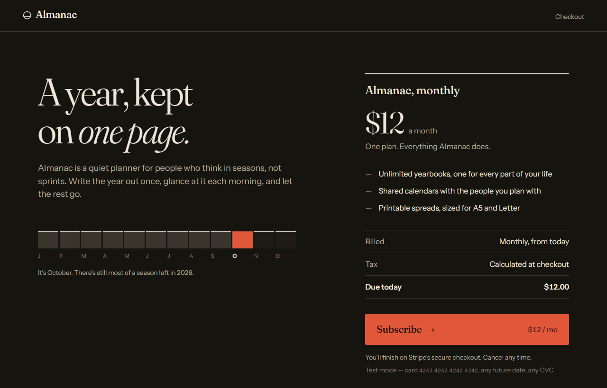
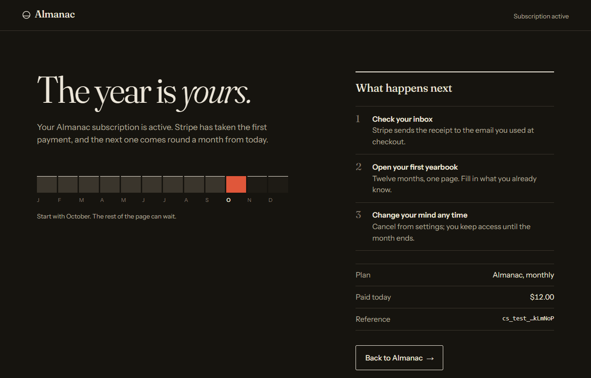
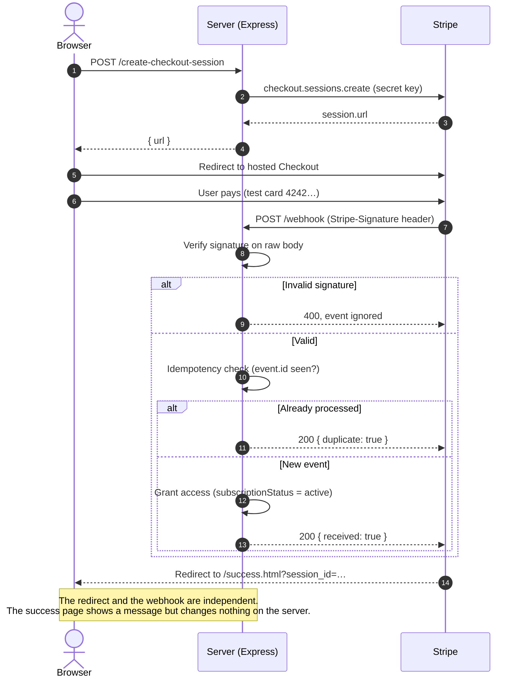
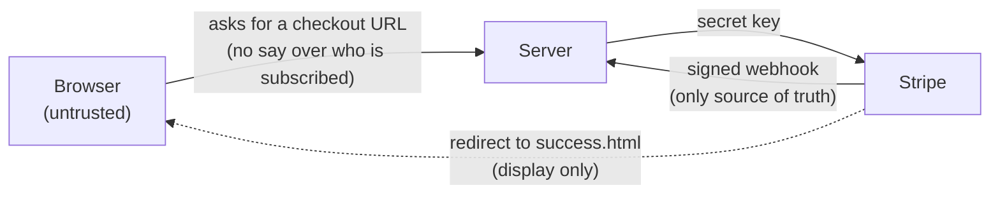

# Stripe Subscriptions

[](https://nodejs.org/)
[](https://github.com/stripe/stripe-node)
[](package.json)
[](#running-locally)

A subscription billing service built on Stripe Checkout and webhooks. Users pay on Stripe's hosted checkout page, and the server marks them as subscribed only when Stripe sends a signed webhook confirming the payment.

**Three ideas hold it together:**

1. **Never trust the browser.** Reaching `success.html` proves nothing, because a redirect can be skipped, refreshed or typed by hand. Access is granted only from the webhook.
2. **Verify every webhook signature.** Each event is checked against the signing secret before anything happens. The `/webhook` route reads the raw body, since Stripe signs the exact bytes. If a JSON parser runs first, verification fails silently.
3. **Process each event once.** Stripe may deliver the same event more than once. Each handled event id is recorded, and repeats are acknowledged and skipped.

| Subscribe | Success |
|---|---|
|  |  |

## The flow



## Trust boundary



The server accepts exactly one kind of input that changes someone's subscription: a webhook with a valid Stripe signature. Nothing the browser sends can do that.

## Running locally

This needs a Stripe account in test mode. The server won't start without `STRIPE_SECRET_KEY`.

```bash
npm install
cp .env.example .env   # then fill in the values below
```

| Variable | Where it comes from |
|---|---|
| `STRIPE_SECRET_KEY` | Stripe Dashboard → Developers → API keys (test mode) |
| `STRIPE_PRICE_ID` | A recurring product's price, created in the Dashboard |
| `STRIPE_WEBHOOK_SECRET` | Printed by `stripe listen` (starts with `whsec_`) |

Forward webhooks to the server with the [Stripe CLI](https://stripe.com/docs/stripe-cli), then start it:

```bash
stripe listen --forward-to localhost:4242/webhook
npm run dev
```

Open `http://localhost:4242`, click **Subscribe**, and pay with `4242 4242 4242 4242` (any future expiry, any CVC). The server logs each webhook as the subscription activates.

## Endpoints

| Method | Route | Purpose |
|---|---|---|
| POST | `/create-checkout-session` | Creates a Checkout session and returns its URL |
| POST | `/webhook` | Verifies and handles Stripe events |
| GET | `/api/customers` | Lists known subscribers and their status |

Handled events: `checkout.session.completed`, `customer.subscription.updated`, `customer.subscription.deleted`. Other event types are acknowledged and ignored.

## Stack and limits

Node, Express, the Stripe API, and plain HTML/CSS. State is kept in memory ([`src/db.js`](src/db.js)) behind an interface shaped like a database layer. A restart clears all subscribers **and** the list of processed event ids, so this is a demo, not production storage.

## What I'd add next

- PostgreSQL behind the existing `db` interface.
- A customer portal link (`stripe.billingPortal.sessions.create`) so users can manage or cancel their plan.
- Auth, so a subscription belongs to a logged-in user rather than only a Stripe customer id.

---

MIT
